# metaplot

<!-- badges: start -->

Visualize m6A (or any other RNA modification) peaks across 5'UTR, CDS and 3'UTR
regions, and inspect where a motif of interest sits relative to the peak centre.

<!-- badges: end -->

---

## Installation

You can install the development version of metaplot like so:

``` r
# install.packages("devtools")
devtools::install_github("junjunlab/metaplot")

# or
remotes::install_github("junjunlab/metaplot")
```

---

## What is in the package

### Functions

| Function | What it does |
| --- | --- |
| `prepare_features()` | Read a GTF, keep the longest transcript per gene, return a `GRanges` of 5'UTR / CDS / 3'UTR segments |
| `calculate_relative_position()` | Map peak midpoints onto a common meta-gene coordinate |
| `metaPlot()` | Draw the density metaplot for one or several samples |
| `getSeqFromBed()` | Extract peak sequences from a genome FASTA *(needs Python)* |
| `findMotif()` | Find motif occurrences inside those sequences *(needs Python)* |
| `CalculatePeaksRelativeDist()` | Distance between each motif hit and the peak centre *(needs Python)* |
| `plotRelMotif()` | Density plot of those distances *(needs Python)* |
| `%>%` | magrittr pipe, re-exported for convenience |

### Bundled example data

Everything below is shipped in `inst/extdata`, so the examples in this README
can be copy-pasted and run as-is right after installing the package.

| File | Content |
| --- | --- |
| `hg38.ncbiRefSeq.gtf.gz` | hg38 RefSeq annotation, UCSC-style `type` labels |
| `m6a_peaks.bed` | 20,435 m6A MeRIP-seq peaks |
| `m1a.sorted2.bed` | 2,234 m1A peaks |
| `helaA30ko-1.m1a.sorted2.bed` | 2,250 m1A peaks from a knockout HeLa sample |
| `m6a_peaks.fa` | 3,000 m6A peak sequences (50–500 bp), ready-made input for the motif helpers |

---

## Quick start

Three calls are enough for the standard meta-gene plot:

``` r
library(metaplot)

gtf_file <- system.file("extdata", "hg38.ncbiRefSeq.gtf.gz", package = "metaplot")
m6a_bed  <- system.file("extdata", "m6a_peaks.bed", package = "metaplot")

# 1. annotation, computed once per genome
features_anno <- prepare_features(gtf_file, features_name = c("5UTR", "CDS", "3UTR"))

# 2. + 3. map peaks and plot
res <- metaPlot(
  bed_file      = list(m6a_bed),
  group_names   = "m6A",
  features_anno = features_anno,
  scale_region  = TRUE
)

res$plot
```

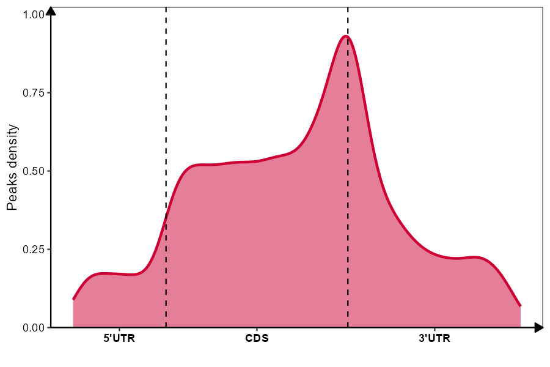

The rest of this document walks through every function and every argument. The
examples reuse `features_anno` from above and these additional paths:

``` r
m1a_bed    <- system.file("extdata", "m1a.sorted2.bed", package = "metaplot")
helako_bed <- system.file("extdata", "helaA30ko-1.m1a.sorted2.bed", package = "metaplot")
m6a_fa     <- system.file("extdata", "m6a_peaks.fa", package = "metaplot")
```

---

## 1. Build the annotation: `prepare_features()`

`prepare_features()` reads a GTF, keeps **one transcript per gene** (the one
with the largest summed exon length), and returns the 5'UTR / CDS / 3'UTR
segments of those transcripts as a `GRanges`.

``` r
features_anno <- prepare_features(
  gtf_file      = gtf_file,
  features_name = c("5UTR", "CDS", "3UTR")   # UCSC/RefSeq labels
)
```

`features_name` must be a character vector of length 3, given **in the order
5'UTR, CDS, 3'UTR**. Different annotation sources use different labels:

| Source | `features_name` |
| --- | --- |
| Ensembl | `c("five_prime_utr", "CDS", "three_prime_utr")` *(default)* |
| UCSC / RefSeq | `c("5UTR", "CDS", "3UTR")` |
| GENCODE | `c("5UTR", "CDS", "3UTR")` |

What you get back (abbreviated):

``` r
features_anno
#> GRanges object with 233837 ranges and 7 metadata columns:
#>          tx_len        type     f_len      gene_id    gene_name  transcript_id
#> 1           956         CDS       956          ND1          ND1        rna-ND1
#> 2          1042         CDS      1042          ND2          ND2        rna-ND2
#> ...         ...         ...       ...          ...          ...            ...
#> 233837      421        UTR3       421 LOC112268260 LOC112268260 XM_047436352.1
#>         trans_len
#> 1             956
#> ...          ...
#> 233837      1819
```

Each row is one exon-level segment; `f_len` is the summed length of that
feature type across the whole transcript, and `tx_len` is the cumulative length
up to and including this segment (counted in transcript orientation, so the
minus strand is handled correctly).

``` r
as.data.frame(features_anno) |> dplyr::count(type)
#>   type      n
#> 1  CDS 181031
#> 2 UTR3  19790
#> 3 UTR5  33016
```

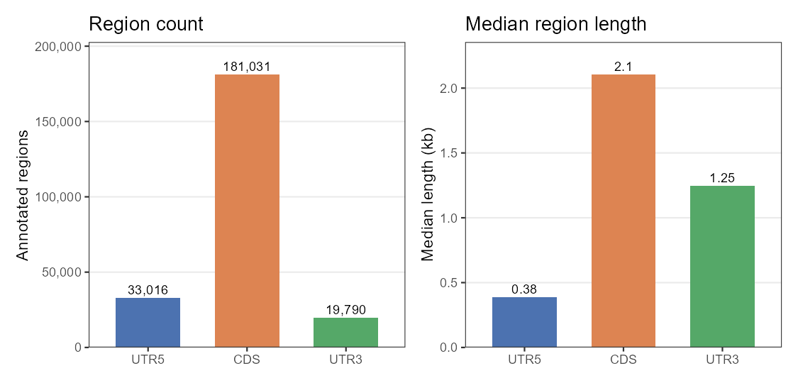

19,539 transcripts remain after the longest-transcript filter. The CDS is the
largest region (median 2.1 kb per transcript), while the median 5'UTR is only
0.38 kb — which is exactly why `scale_region` exists (see
[section 3.2](#32-scale_region-true-real-transcript-proportions)).

`features_anno` only needs to be computed once per genome and can be reused
across every `metaPlot()` call, so it is worth saving:

``` r
saveRDS(features_anno, "hg38_features_anno.rds")
```

---

## 2. The underlying coordinates: `calculate_relative_position()`

`metaPlot()` is a thin plotting layer on top of this function, which is
exported so you can inspect or reuse the numbers behind the figure.

``` r
rel_df <- calculate_relative_position(
  bed_file      = m6a_bed,
  features_anno = features_anno,
  scale_region  = TRUE
)

head(rel_df)
#>    type  rel_pos
#> 1   CDS 1.129853
#> 2  UTR3 2.011796
#> 3  UTR3 2.071849
#> 4   CDS 1.284665
#> ...
```

### How the coordinate system works

Every feature type is normalised to a length of 1 and stacked along the x-axis:

```
     5'UTR            CDS            3'UTR
  |-----------|----------------|-----------|
  0           1                2           3
```

* `rel_pos` in `[0, 1]` → 5'UTR
* `rel_pos` in `[1, 2]` → CDS
* `rel_pos` in `[2, 3]` → 3'UTR

A peak is counted only when its **midpoint** falls inside a feature, which is
why 20,435 input peaks produce 11,833 rows here — the rest fall in introns or
intergenic space.

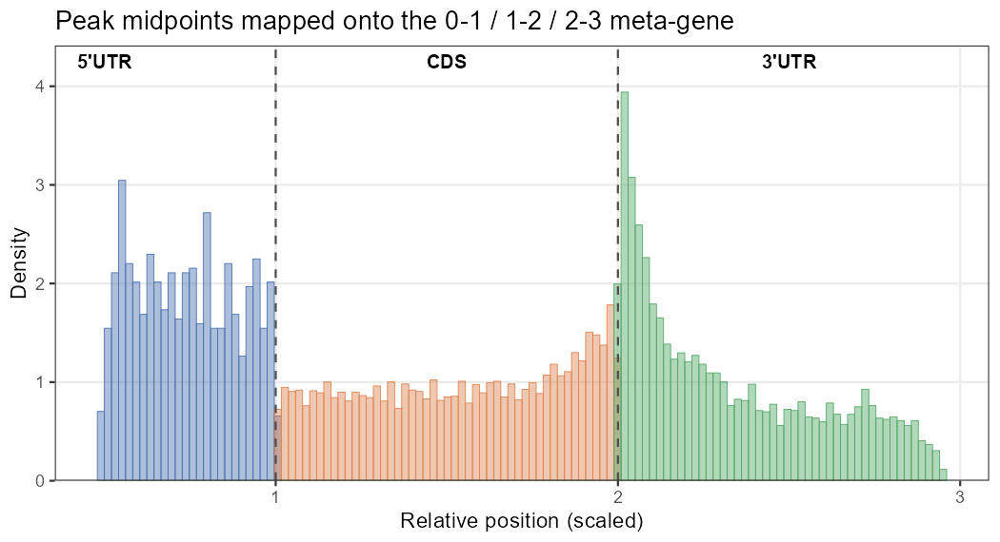

With `scale_region = TRUE` the 5'UTR and 3'UTR are not drawn at full width but
compressed/expanded by their median length relative to the CDS, so the panel
widths reflect real transcript proportions.

---

## 3. Draw the plot: `metaPlot()`

### 3.1 One sample

``` r
res <- metaPlot(
  bed_file      = list(m6a_bed),
  group_names   = "m6A",
  features_anno = features_anno,
  scale_region  = TRUE
)

res$plot
```

`bed_file` accepts a list of BED paths, or a single BED path / `data.frame` /
`GRanges` object without wrapping it in a list.

### 3.2 `scale_region = TRUE`: real transcript proportions

``` r
res_equal  <- metaPlot(list(m6a_bed), "m6A", features_anno, scale_region = FALSE)
res_scaled <- metaPlot(list(m6a_bed), "m6A", features_anno, scale_region = TRUE)
```

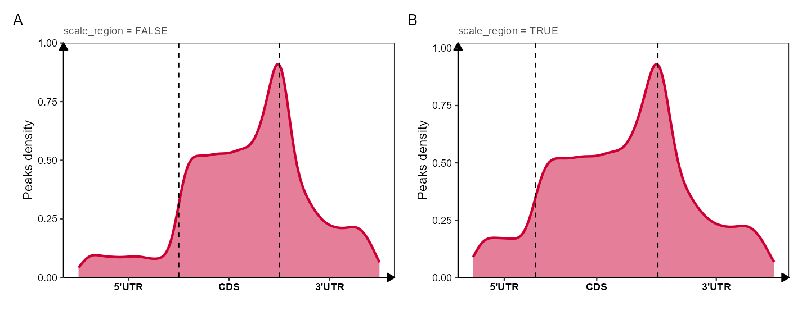

With `scale_region = FALSE` (A) all three regions occupy the same width, so a
5'UTR that is 0.38 kb and a CDS that is 2.1 kb look identical. With
`scale_region = TRUE` (B) the region widths follow the median lengths observed
in the annotation, and the tick labels are placed at the centre of each
region.

The scaling factors are estimated **once from the whole annotation**, not from
the subset of features that happens to be covered by your peaks, so every
sample in a multi-sample plot shares exactly the same x-axis.

### 3.3 `cut_ratio`: hand-picked proportions

If you would rather fix the proportions yourself, pass a ratio of length 3
(5'UTR : CDS : 3'UTR) instead of relying on the estimated median lengths:

``` r
res_cut <- metaPlot(
  bed_file      = list(m6a_bed),
  group_names   = "m6A",
  features_anno = features_anno,
  scale_region  = TRUE,
  cut_ratio     = c(0.1, 0.8, 0.1)
)
```

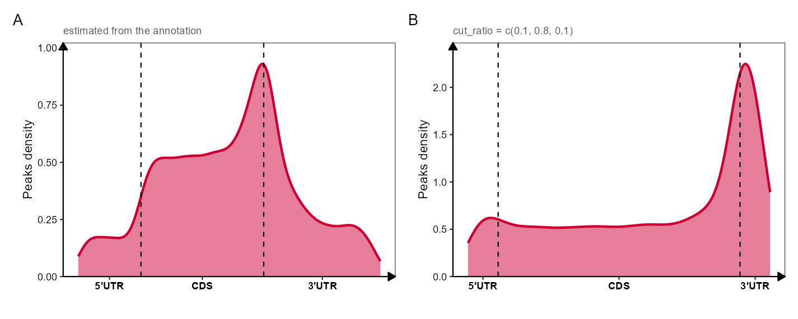

`cut_ratio` only takes effect together with `scale_region = TRUE`; if you set
it while `scale_region = FALSE`, `metaPlot()` warns and ignores it.

### 3.4 Several samples on one axis

``` r
res <- metaPlot(
  bed_file      = list(m6a_bed, m1a_bed, helako_bed),
  group_names   = c("m6A", "m1A", "m1A_helaA30KO"),
  features_anno = features_anno,
  scale_region  = TRUE
)

res$plot
```

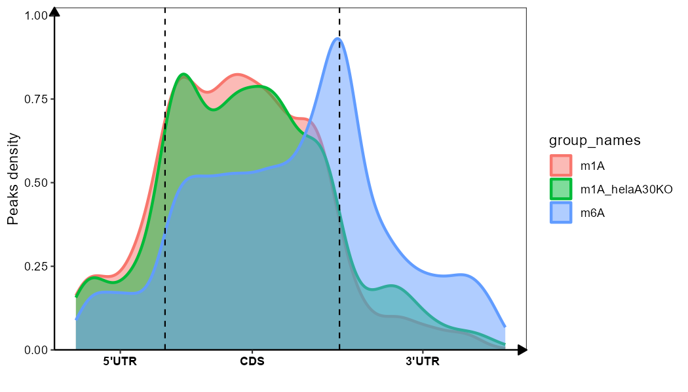

The legend title comes from the internal column name; rename it on the
returned ggplot object if you prefer something cleaner:

``` r
res$plot + ggplot2::labs(fill = "Group", colour = "Group")
```

### 3.5 `facet = TRUE`: one panel per group

Overlaid densities get hard to read beyond two or three groups; faceting gives
each sample its own panel.

``` r
res_facet <- metaPlot(
  bed_file      = list(m6a_bed, m1a_bed, helako_bed),
  group_names   = c("m6A", "m1A", "m1A_helaA30KO"),
  features_anno = features_anno,
  scale_region  = TRUE,
  facet         = TRUE
)

res_facet$plot
```

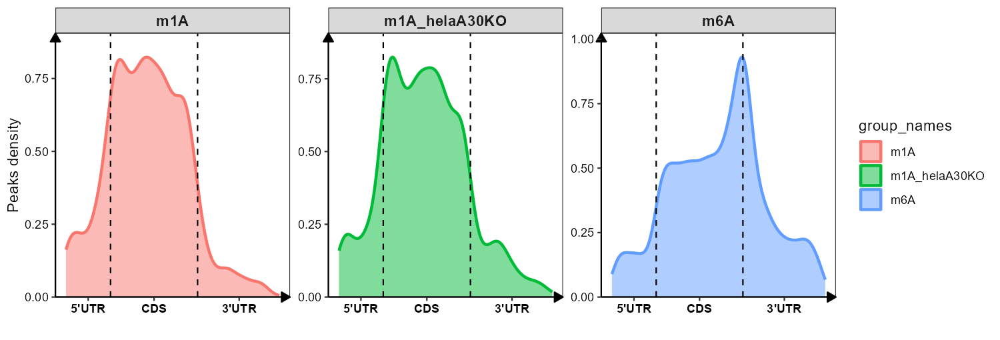

Facets are ordered alphabetically by `group_names`. Convert the column to a
factor first if you need the input order instead.

### 3.6 Styling arguments

| Argument | Effect |
| --- | --- |
| `col_alpha` | transparency of the fill under the density curve |
| `line_width` | width of the density outline |
| `line_color` | colour used when there is a single sample |
| `geom_density_bw` | bandwidth passed to `geom_density()`; smaller = spikier, larger = smoother |
| `geom_density_n` | number of points used to evaluate the density (default `512`) |

``` r
# thinner fill, thicker outline
metaPlot(list(m6a_bed, m1a_bed), c("m6A", "m1A"), features_anno,
         scale_region = TRUE, col_alpha = 0.15, line_width = 1.6)

# bandwidth controls how much detail survives
metaPlot(list(m6a_bed, m1a_bed), c("m6A", "m1A"), features_anno,
         scale_region = TRUE, geom_density_bw = 0.15)
```

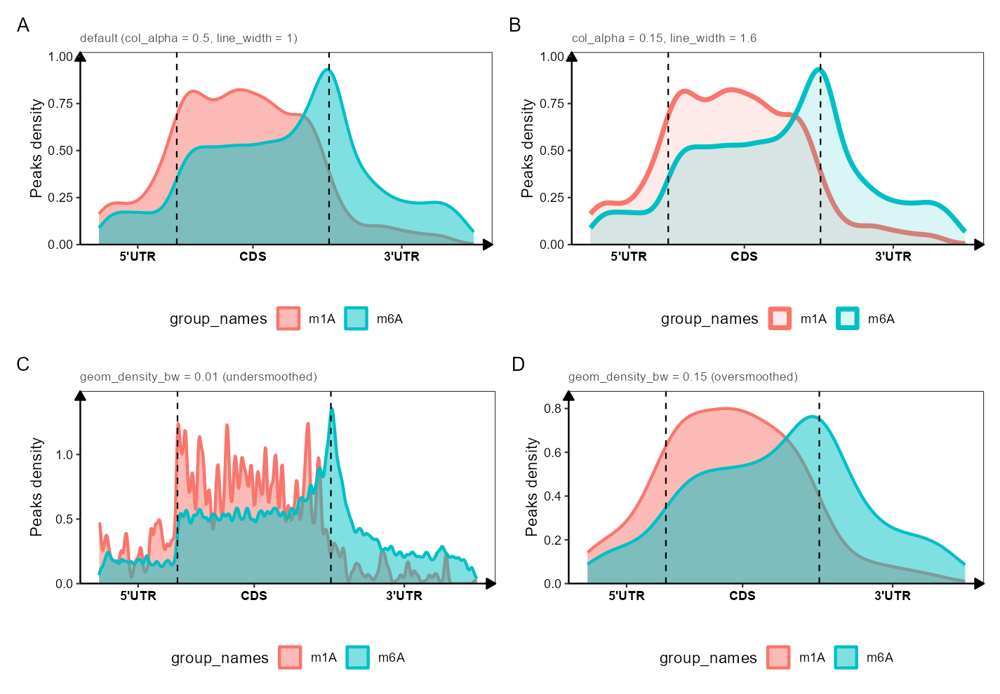

For a single sample, `line_color` replaces the default `"#CC0033"`:

``` r
metaPlot(list(m6a_bed), "m6A", features_anno,
         scale_region = TRUE, line_color = "#2C7FB8", col_alpha = 0.3)
```

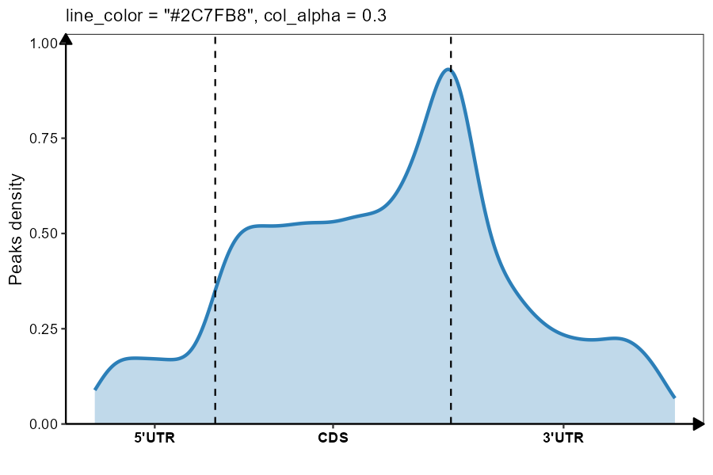

### 3.7 Return value

`metaPlot()` returns a list with two elements, and the plot is a plain ggplot
object, so anything ggplot2 offers keeps working:

``` r
res$data   # data frame with type / rel_pos / group_names
res$plot   # ggplot object

res$plot +
  ggplot2::labs(title = "m6A metaplot", y = "Peak density") +
  ggplot2::theme(legend.position = "bottom")
```

---

## 4. Motif analysis (optional, needs Python)

This part answers a different question: *where inside the peak does the motif
sit?* Four helpers wrap small Python scripts through `reticulate`.

| Step | Function | Input → output |
| --- | --- | --- |
| 1 | `getSeqFromBed()` | BED + genome FASTA → peak sequences (FASTA) |
| 2 | `findMotif()` | peak FASTA → the matched motif sequences |
| 3 | `CalculatePeaksRelativeDist()` | peak FASTA → distance of each hit to the peak centre |
| 4 | `plotRelMotif()` | those distances → density plot |

### 4.1 `getSeqFromBed()`: peaks → sequences

Requires a genome FASTA (not bundled — point it at your own reference):

``` r
getSeqFromBed(
  peak      = m6a_bed,
  genomefie = "hg38.fa",     # note the historical spelling of this argument
  outfasta  = "peaks.fa",
  type      = "bed",         # or "narrowpeak"
  a         = 25,            # extend 25 bp upstream of the peak
  b         = 25,            # extend 25 bp downstream of the peak
  minlen    = 5              # drop sequences shorter than this
)
```

The return value is the number of sequences written to `outfasta`, and every
record is named `peak_name|chrom|start|end|strand`:

```
>1|chr19|58357367|58357517|-
...extracted sequence...
```

`a` and `b` are interpreted in **transcript orientation**: on the minus strand
"upstream" means towards higher coordinates, and the extracted sequence is
reverse-complemented. Both `"bed"` and `"narrowpeak"` are 0-based half-open, so
neither needs a coordinate adjustment.

### 4.2 `findMotif()`: which motif sequences are present

``` r
motif_hits <- findMotif(peaksfa = m6a_fa)   # m6a_fa ships with the package
length(motif_hits)
#> [1] 12220
head(sort(table(toupper(motif_hits)), decreasing = TRUE), 8)
#>
#> GGACT GAACT GGACA AGACT AAACT GAACA AAACA AGACA
#>  1114   959   853   850   822   695   680   646
```

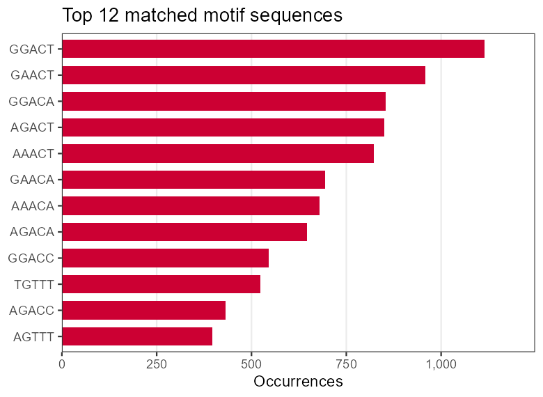

The default motif is `"[GA][GA]AC[ACT]|[TGA]GT[CT][CT]"`, i.e. "RRACH" plus its
reverse complement "DGGYY" (both strands of the same consensus), and matching
is case-insensitive. Pass any regular expression to search for something else:

``` r
findMotif(peaksfa = m6a_fa, motif = "GGAC")
```

### 4.3 `CalculatePeaksRelativeDist()`: where in the peak

``` r
rel_dist <- CalculatePeaksRelativeDist(peaksfa = m6a_fa)
length(rel_dist)
#> [1] 12220
range(rel_dist)
#> [1] -242  244
```

Each value is the distance, in bp, between a motif hit and the centre of the
sequence it came from. `mid = 3` (the default) shifts the hit from the start of
the match to the base of interest inside the motif.

### 4.4 `plotRelMotif()`: the motif metaplot

``` r
plotRelMotif(relpos = list(rel_dist), exp = "m6A")
```

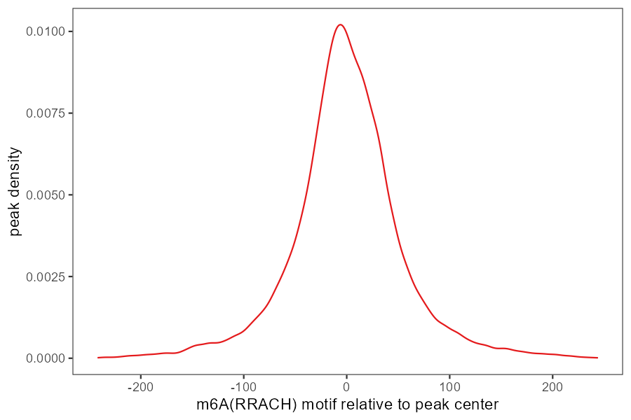

The RRACH motif concentrates sharply at the peak centre — the expected result
for m6A. `relpos` accepts a list, so several samples can be compared on one
axis:

``` r
# rel_dist_m6a / rel_dist_m1a: one vector per sample, as returned above
plotRelMotif(
  relpos    = list(rel_dist_m6a, rel_dist_m1a),
  exp       = c("m6A", "m1A"),
  linewidth = 0.8
)
```

The function returns a ggplot object, so the legend can be dropped for a
single sample with `+ ggplot2::theme(legend.position = "none")`.

### Python setup

`getSeqFromBed()` needs [`pyfaidx`](https://pypi.org/project/pyfaidx/);
`findMotif()` and `CalculatePeaksRelativeDist()` only use the standard library.
If `reticulate` cannot find an interpreter, point it at one explicitly:

``` r
reticulate::install_miniconda()          # or use an existing Python
getSeqFromBed(..., pythonPath = "/path/to/python")
```

---

## 5. Argument reference

### `prepare_features()`

| Argument | Default | Meaning |
| --- | --- | --- |
| `gtf_file` | — | GTF path, gzip accepted |
| `features_name` | `c("five_prime_utr", "CDS", "three_prime_utr")` | Feature labels, in the order 5'UTR, CDS, 3'UTR |

### `calculate_relative_position()`

| Argument | Default | Meaning |
| --- | --- | --- |
| `bed_file` | — | BED path, `data.frame` or `GRanges` of peaks |
| `features_anno` | — | `GRanges` from `prepare_features()` |
| `scale_region` | `FALSE` | Compress/expand UTRs by their real length |
| `cut_ratio` | `NULL` | Manual `c(5'UTR, CDS, 3'UTR)` ratio, used with `scale_region = TRUE` |
| `scale_factors` | `NULL` | Precomputed factors, mainly for internal reuse |

### `metaPlot()`

| Argument | Default | Meaning |
| --- | --- | --- |
| `bed_file` | — | List of BED paths / `data.frame`s / `GRanges`, or a single one |
| `group_names` | `NULL` | One label per sample; defaults to the file names |
| `features_anno` | — | `GRanges` from `prepare_features()` |
| `scale_region` | `FALSE` | Use real feature proportions |
| `cut_ratio` | `NULL` | Manual ratio, requires `scale_region = TRUE` |
| `facet` | `FALSE` | One panel per group |
| `geom_density_bw` | `NULL` | Bandwidth for `geom_density()` |
| `geom_density_n` | `512` | Number of density evaluation points |
| `col_alpha` | `0.5` | Fill transparency |
| `line_color` | `"#CC0033"` | Colour for a single sample |
| `line_width` | `1` | Outline width |

---

## 6. Troubleshooting

**`No peak falls within the annotated features`** — the peaks and the
annotation do not agree on chromosome naming. `chr1` vs `1` is the usual
culprit; convert one side with `GenomeInfoDb::seqlevelsStyle()` before
plotting.

**`No feature matched features_name`** — the GTF uses different `type` labels.
Inspect them with `table(rtracklayer::import(gtf_file)$type)` and pass the
right ones to `features_name`.

**`features_anno contains no CDS feature`** — `scale_region = TRUE` needs a CDS
to scale against. Either pass `cut_ratio` explicitly or set
`scale_region = FALSE`.

**`group_names has length ... but bed_file has ... sample(s)`** — the two must
have the same length; `group_names` is matched to `bed_file` by position.

**`Please install python first!`** — `reticulate` found no interpreter. See
[Python setup](#python-setup).

---

## Citation

> Jun Zhang (2024). *Visualizing m6A Distribution on RNA.* https://github.com/junjunlab/metaplot

---

## Related blogs

[写个包 metaplot 绘制 m6A peak 分布](https://mp.weixin.qq.com/s?__biz=MzkyMTI1MTYxNA==&mid=2247512922&idx=1&sn=247004f40306ea4e555fb6e32480a42f&chksm=c184892bf6f3003d132a9779834b2d4df5c3f1b52ec9c3a04041d7398f3ec155560efe6eb578&token=709285857&lang=zh_CN#rd)

---

*All figures in this README are regenerated by
[`data-raw/make-readme-figures.R`](data-raw/make-readme-figures.R).*
